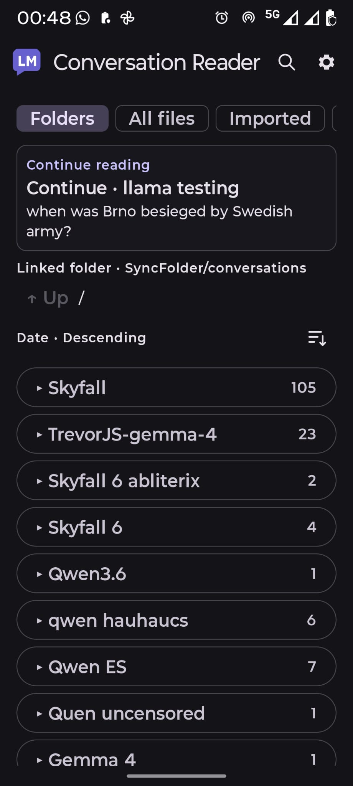
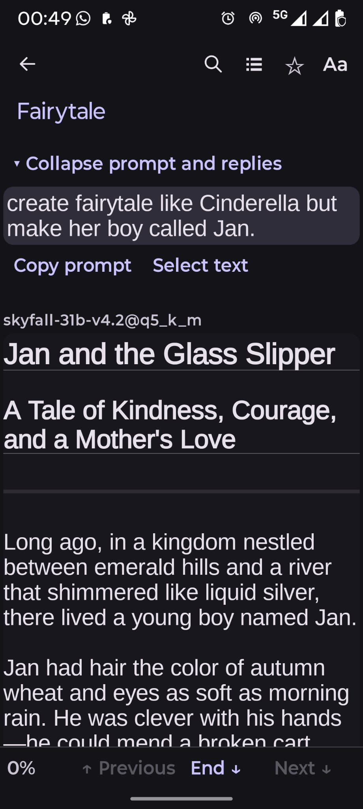

# LM Studio Conversation Reader

**A pocket library for your LM Studio conversations.**

Take your stories, research, coding answers and late-night rabbit holes with you. Conversation Reader turns saved LM Studio chats into a comfortable Android reading experience, with formatted replies, a searchable library and a place waiting for you when you come back.

**Offline. Private. Open source.** No account or connection to LM Studio required.

[**Download the Android APK**](https://github.com/jen9czech/lm-studio-conversation-reader/releases/latest) · Android 8.0+ · [MIT license](LICENSE)

Compatible with **LM Studio 0.4.28 (Build 2)** conversation JSON files.

## A look inside

<table>
  <tr>
    <th>Your library</th>
    <th>Time to read</th>
    <th>Make it comfortable</th>
  </tr>
  <tr>
    <td></td>
    <td></td>
    <td></td>
  </tr>
</table>

## Give your conversations a second life

- **Bring the whole archive.** Link a folder on your phone and browse its original subfolders, or see every conversation in one list. Titles come from the conversation itself. Folder counts and sorting by date, name or length help you find your way.
- **Read comfortably.** Enjoy Markdown headings, tables, code blocks and selectable text. Choose Liberation Sans, Times-like Liberation Serif or Courier Prime, adjust the text size, and switch between light, dark and system themes.
- **Find that answer again.** Search titles and conversation contents offline, see matching snippets, and jump to highlighted results. Search inside a conversation with a result counter and previous/next controls; accent-insensitive matching helps with Czech text too.
- **Pick up where you left off.** Continue reading and Recent bring you back to your archive. A single star saves a conversation to Bookmarked. Remembered text positions and a separate Return to reading action help you keep your place while exploring search results or chapters.
- **Move through long conversations.** Collapse prompt-and-reply groups, jump through prompts and headings in Contents, or drag the scroll slider. Reading progress and navigation stay together at the bottom.
- **Keep the useful details.** Inspect model names, word counts, saved token totals and generation statistics when available. Read alternate saved message versions, copy text or code, and open a source file in an external reader.

All of this works on your phone, without running a model. Your next great reading session might already be sitting in your conversations folder.

## Start reading in a minute

1. Download the APK from [Releases](https://github.com/jen9czech/lm-studio-conversation-reader/releases/latest) and open it on your phone. Android may ask you to allow installation from your file manager.
2. Copy your LM Studio conversation files from your PC to a dedicated phone folder, then link that folder in Settings. You can also import individual files.
3. Open a conversation and read. Star the ones you want to revisit.

After copying more files, restart the app or choose **Update index now** in Settings. The library also checks the linked folder at startup and after changing folders. Cached metadata speeds up later scans; indexing shows progress and per-file errors.

Install updates over the existing app to retain your library and preferences. Published APKs are debug-signed testing builds; in-place updates require the same signing certificate.

## Your files stay yours

Linked conversations open directly and remain unchanged. Importing an individual file creates an independent local copy in Imported; simply opening a linked conversation does not import it.

The app has **no Internet permission**, accounts, telemetry or cloud backup. Its search index stays on the device. Web and email links open external apps only when you select them.

## Compatibility and scope

- Reads LM Studio conversation JSON in `.json` and `.conversation` files, up to 20 MB per file.
- Tested with **LM Studio 0.4.28 (Build 2)** files. Available metadata depends on what LM Studio saved.
- Designed for reading saved conversations. It does not generate replies, edit conversations or synchronize files with your PC.
- Image attachments and LaTeX rendering are not supported. Word counts and reading progress are approximate.

<details>
<summary><strong>Build from source and run checks</strong></summary>

Open the project in Android Studio, or configure JDK 17 and Android SDK 36 with Build Tools 35.0.0. Set the SDK location in an untracked `local.properties` file or through `ANDROID_HOME`.

Windows:

```powershell
.\gradlew.bat assembleDebug testDebugUnitTest lintDebug
```

macOS/Linux:

```sh
sh gradlew assembleDebug testDebugUnitTest lintDebug
```

The Gradle wrapper downloads the required build dependencies. The APK is generated at `app/build/outputs/apk/debug/app-debug.apk`.

Tests use synthetic conversations. The optional [Android simulation suite](audit/README.md) also checks navigation, search, bookmarks, reading-position restoration, indexing and native font rendering. GitHub Actions runs build, test and lint checks. Layout, touch gestures and file-manager integration should also be checked on an Android device.

</details>

## License and credits

[MIT](LICENSE). Bundled Liberation and Courier Prime fonts use the SIL Open Font License; see [font notices](THIRD_PARTY_NOTICES.md).

An independent project, made for LM Studio readers and not affiliated with LM Studio.
